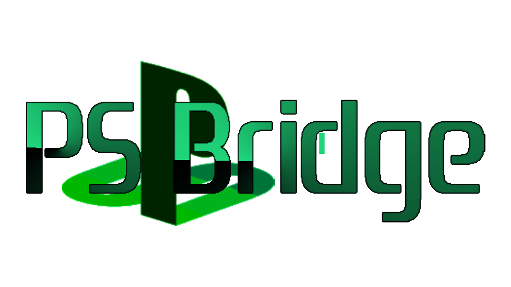
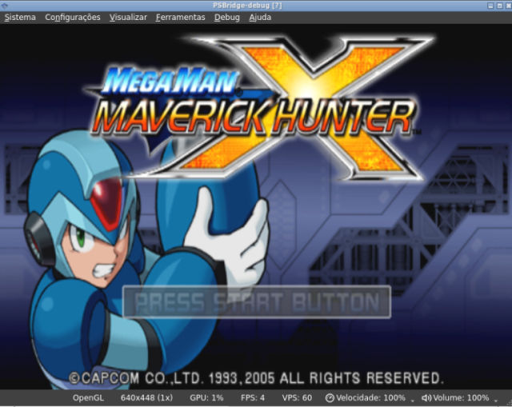
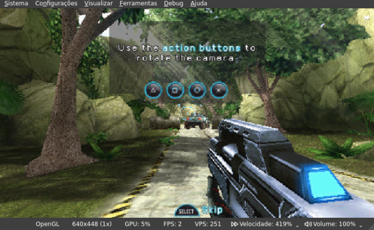

# PSBridge

<p align="center">
  
</p>

psbridge is an experimental compatibility and recompilation project focused on bringing psp software to the playstation 2.

instead of emulating the psp cpu instruction-by-instruction, psbridge aims to translate psp allegrex code into code that can run on the playstation 2's r5900 processor, while providing the compatibility needed for psp software to run on ps2 hardware.

> this project is still experimental and is not intended to provide full psp compatibility yet.

## How it works

the general idea is:

```text
psp executable
     ↓
analysis
     ↓
allegrex → r5900 recompilation
     ↓
psbridge runtime
     ↓
playstation 2 elf
```

psbridge tries to avoid running a complete virtual psp cpu.

whenever possible, psp code is translated ahead of time into native ps2 code.

some parts may still require runtime handling depending on how the original software behaves.

## Main goals

* recompile allegrex code to r5900
* provide a compatibility layer between psp and ps2
* reuse the original game data and resources
* produce native ps2 elf executables
* keep runtime overhead as low as possible
* make porting psp software to the ps2 easier

## Project status

psbridge is still experimental and roughly 40% of the way toward its initial goals.

some psp games already boot through psbridge in pcsx2. mega man maverick hunter x reaches the title screen, and n.o.v.a. reaches the opening tutorial.

compatibility, performance, and accuracy are not guaranteed.

### Screenshots

**Mega Man Maverick Hunter x**



**N.O.V.A.**



## Legal notice

psbridge is an independent open-source project and is not affiliated with, endorsed by, or associated with sony interactive entertainment.

psbridge does not include or distribute:

* psp games
* playstation 2 games
* sony firmware
* bios files
* sdk files
* proprietary sony code
* copyrighted game assets

users are responsible for providing legally obtained software and files required for testing.

playstation, psp, and playstation 2 are trademarks of sony interactive entertainment.

## License

psbridge is licensed under the apache license 2.0.

you are free to use, modify, and redistribute the project under the terms of the license.

copyright and attribution notices must be preserved when redistributing the software or modified versions of it.

see the `LICENSE` and `NOTICE` files for more information.

## Contributing

contributions, research, testing, documentation, and technical discussion are welcome.

the project is still very early, so there is plenty of stuff to work on.

## Disclaimer

this project is mainly made for research, experimentation, preservation, and learning.

expect bugs.

a lot of them.
